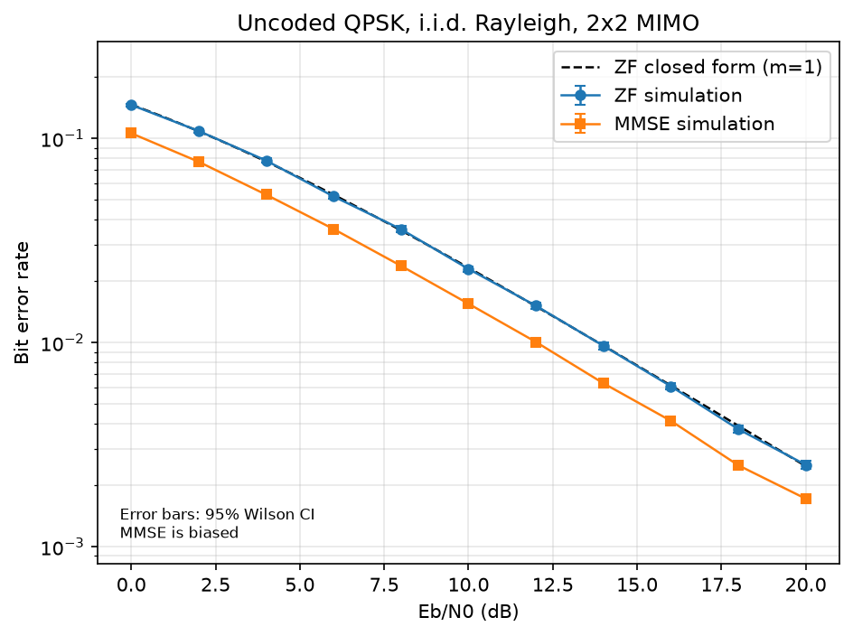
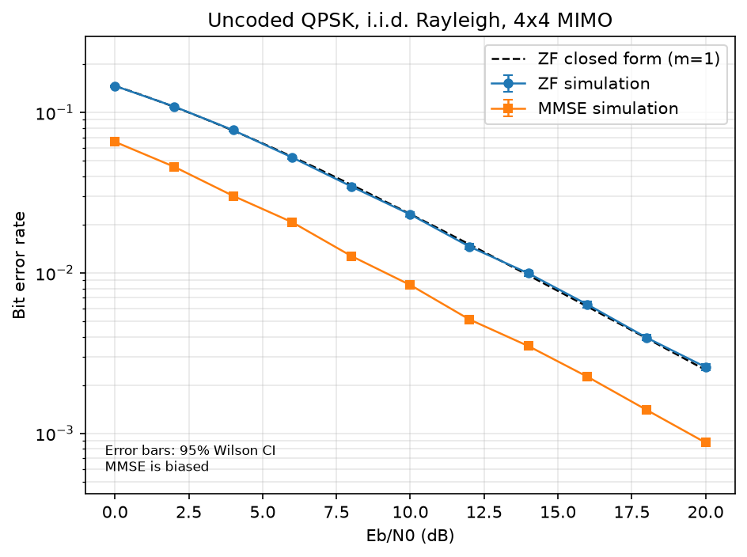

# Wireless PHY Learning Lab

A research-oriented simulation framework for the wireless physical layer, focused on
**MIMO detection** with classical linear receivers as a rigorously validated baseline, and
model-driven / learned detectors as the research target.

> **Status: validated baseline.** QPSK, spatial-multiplexed MIMO, flat Rayleigh fading, calibrated
> AWGN, ZF/MMSE detection, and a seeded Monte Carlo BER engine are implemented. The first 2x2 and
> 4x4 BER experiments are stored in `results/` with their configuration and seeds. ML and SIC are
> not implemented. These are simulation results, not measurements.

---

## Overview

The project studies the narrowband spatial-multiplexing MIMO detection problem:

```
y = H s + n
```

with `Nt` transmit and `Nr` receive antennas, and asks a deliberately narrow question first:

> Given perfect channel state information and a flat Rayleigh channel, how do zero-forcing, MMSE
> and maximum-likelihood detection actually compare in bit error rate, and what is the *measured*
> diversity order of each?

Only once that baseline is reproducible and validated against closed-form results does the project
move to learned detectors. A learned detector that has not been compared against an exhaustive
maximum-likelihood bound in the same simulator is not evidence of anything.

---

## Research objectives

1. Establish a **validated** classical baseline. Every detector must reproduce an independently
   derived reference curve before it is used to judge anything else.
2. Measure, not assume, the **diversity order** of each detector. Linear receivers are known to
   saturate; the project demonstrates this numerically rather than quoting it.
3. Build a simulation harness whose statistics are defensible: confidence intervals, an error-count
   stopping rule, and paired comparisons across detectors.
4. Then, and only then, ask whether a model-driven detector closes part of the gap to maximum
   likelihood — with a pre-registered hypothesis, so a null result is reportable.

**Non-goals at this stage:** coding, OFDM, channel estimation, hardware, standard compliance.

---

## System model

| Element | Choice |
|---|---|
| Duplexing | single link, no uplink/downlink distinction |
| Bandwidth | narrowband, frequency-flat (one channel matrix per channel use) |
| Antennas | `Nt = Nr = 2` and `Nt = Nr = 4`; `4x2` used as a rectangular validation case |
| Modulation | QPSK, Gray-mapped, unit average symbol energy |
| Channel | i.i.d. circularly-symmetric complex Gaussian, unit average power gain |
| Noise | spatially and temporally white AWGN |
| CSI | perfect at the receiver, **plus known noise variance** |
| Coding | none; uncoded bit error rate |

### Conventions

- Complex baseband. Vectors are bold lowercase, matrices bold uppercase, `(.)^H` is conjugate
  transpose.
- After normalisation, symbol energy is `Es = 1` and the noise variance per complex dimension is
  `sigma^2 = 1/rho`, with `rho = Es/N0` dimensionless.
- Reported BER is an **ensemble average over the channel**, not a property of a single realisation.
- The forward error rate is reported against `Eb/N0`, because only that axis makes `2x2` and `4x4`
  comparable at equal total transmit power.

---

## Mathematical formulation summary

The full derivation, with units, assumptions, and verification status for every equation, is
maintained in the project's internal research notes.

**Received signal**

```
y = H s + n,      H in C^{Nr x Nt},   n ~ CN(0, sigma^2 I),   E[s s^H] = Es I
```

**Detection rules**

```
ZF      G = (H^H H)^{-1} H^H
MMSE    G = (H^H H + sigma^2 I)^{-1} H^H          (Es = 1)
ML      s_hat = argmin_{s in S^Nt} || y - H s ||^2
```

**Post-detection noise and per-stream SNR**

```
E[e e^H] = sigma^2 (H^H H)^{-1}                                  (ZF)

gamma_k^ZF    = rho h_k^H P_k^perp h_k                          (exact)
gamma_k^MMSE  = 1 / [ (I + rho H^H H)^{-1} ]_kk  -  1            (exact identity)
```

**Exact ZF bit error rate for QPSK** (no Gaussian approximation is involved), with
`m = Nr - Nt + 1` and `mu = sqrt(rho / (2 + rho))`:

```
P_b^ZF(rho) = ( (1 - mu)/2 )^m  *  sum_{k=0}^{m-1} C(m-1+k, k) ( (1 + mu)/2 )^k
```

This reduces to `(1/2)(1 - sqrt(rho/(rho+2)))` for a square array and provides a zero-variance
reference curve against which the simulator can be validated exactly.

**Diversity order** (`d = -lim log P_b / log rho`)

| Detector | General | Square array |
|---|---|---|
| ZF | `Nr - Nt + 1` | 1 |
| MMSE | `Nr - Nt + 1` | 1 |
| ML (spatial multiplexing) | `Nr` | `Nt` |

---

## Implemented algorithms

| Component | Status |
|---|---|
| QPSK mapping and demapping | implemented in `modulation/qpsk.py`; unit-energy, Gray-mapped, tested against the AWGN closed form |
| MIMO transmit signal generation | implemented in `mimo.py`; independent Gray-QPSK streams, `x` shape `(Nt, Ns)`, `||x||^2 = Nt` per column |
| Flat Rayleigh channel generator | implemented in `channel/rayleigh.py`; i.i.d. `CN(0, 1)`, seeded, `E[||H||_F^2] = Nt Nr` |
| AWGN generator with SNR calibration | implemented in `channel/awgn.py`; `sigma^2 = 1/(Es/N0)`, seeded, with circularity and per-rail variance tests |
| Zero forcing detector | implemented in `detection/linear.py`; direct normal-equation solve, no inverse, `Nr >= Nt`, condition-number diagnostic |
| MMSE detector | implemented in `detection/linear.py`; biased variant (D-05), `(H^H H + sigma^2 I)^{-1} H^H`, tested against the explicit definition |
| Monte Carlo BER engine | implemented in `evaluation/`; binomial error counts, Wilson confidence intervals, seeded error-count stopping |
| BER experiment and plots | implemented in `experiments/ber_mimo.py` and `experiments/plot_ber_mimo.py`; 2x2 and 4x4 results in `results/` |
| Exhaustive maximum-likelihood detector | not started |

---

## Installation

Requires Python 3.10 or newer.

The project is developed in a conda environment. No other virtual environment is used.

```bash
git clone https://github.com/Amirhossein-Solati/wireless-phy-learning-lab.git
cd wireless-phy-learning-lab
conda create -n phy-lab python=3.11
conda activate phy-lab
pip install -e ".[dev,plot,config]"
```

Run the checks:

```bash
ruff check src tests experiments
pytest -q
```

---

## Usage examples

QPSK mapping, demapping, and the `Es = 2 Eb` conversion:

```python
import numpy as np

from wireless_phy_lab.channel import awgn
from wireless_phy_lab.modulation import qpsk

bits = np.array([[0, 0], [0, 1], [1, 0], [1, 1]], dtype=np.uint8)
symbols = qpsk.map_bits(bits)
print(symbols)
# [ 0.70710678+0.70710678j  0.70710678-0.70710678j -0.70710678+0.70710678j
#  -0.70710678-0.70710678j]

print(qpsk.demap(symbols))
# [[0 0]
#  [0 1]
#  [1 0]
#  [1 1]]

print(np.mean(np.abs(symbols) ** 2))
# 1.0

# Es/N0 for a target Eb/N0, then the complex noise variance at that point.
eb_n0_db = 6.0
es_n0 = qpsk.es_n0_from_eb_n0(10.0 ** (eb_n0_db / 10.0))
print(1.0 / es_n0)
# 0.125594321575479

# The same variance, measured on a seeded noise realisation.
noise = awgn.generate_noise(1_000_000, es_n0, rng=np.random.default_rng(0))
print(np.mean(np.abs(noise) ** 2))
# 0.12555099180448068
```

The bit array is interpreted along its last axis: `bits[..., 0]` drives the in-phase rail and
`bits[..., 1]` the quadrature rail. Bit 0 selects the positive rail. The AWGN generator is
modulation-agnostic and takes a linear `Es/N0`; convert with `qpsk.es_n0_from_eb_n0` first.

A spatial-multiplexed MIMO frame and the corresponding received signal:

```python
import numpy as np

from wireless_phy_lab import mimo
from wireless_phy_lab.channel import awgn, rayleigh
from wireless_phy_lab.modulation import qpsk

es_n0 = qpsk.es_n0_from_eb_n0(10.0 ** (6.0 / 10.0))   # 6 dB Eb/N0

rng = np.random.default_rng(1)
bits, x = mimo.generate_transmit_signal(2, 1_000, rng=rng)
channel = rayleigh.generate_rayleigh(2, 2, (1_000,), rng=rng)
noise = awgn.generate_noise((1_000, 2), es_n0, rng=rng)
y = np.einsum("sij,js->si", channel, x) + noise

print(bits.shape, x.shape, channel.shape, y.shape)
# (2, 1000, 2) (2, 1000) (1000, 2, 2) (1000, 2)

print(np.unique(np.sum(np.abs(x) ** 2, axis=0)))
# [2.]
```

`x[j, s]` is the symbol transmitted from antenna `j` in channel use `s`. Every column carries
`Nt` unit-energy symbols, so `||x[:, s]||^2 = Nt`. The channel has one independent matrix per
channel use, and `y[s] = channel[s] @ x[:, s] + noise[s]`. The composition is written explicitly
here; there is no link wrapper yet, and the detectors consume `channel` and `y` directly.

Zero forcing and biased MMSE on the same frame:

```python
from wireless_phy_lab.detection import mmse_detect, zf_detect

noise_variance = 1.0 / es_n0
x_zf = zf_detect(channel, y)
x_mmse = mmse_detect(channel, y, noise_variance)

print(x_zf.shape, x_mmse.shape)
# (1000, 2) (1000, 2)

# Noiseless ZF recovers the transmitted frame. MMSE is biased, but for QPSK
# the real positive bias does not change the hard decisions.
clean = np.einsum("sij,sj->si", channel, x.T)
print(np.allclose(zf_detect(channel, clean), x.T, atol=1e-12))
# True
```

`zf_detect` solves `(H^H H) x = H^H y` directly and requires `Nr >= Nt`. `mmse_detect` solves
`(H^H H + sigma^2 I) x = H^H y`; its argument is the complex noise variance, not an SNR. Both
return symbol estimates of shape `(Ns, Nt)` for batched input; apply `qpsk.demap` for bits.

Run the reproducible BER experiment and regenerate the figures:

```bash
python experiments/ber_mimo.py
python experiments/plot_ber_mimo.py
```

The simulation configuration is `experiments/configs/ber_mimo.yaml`. The exact configuration used,
the per-point seeds, and the raw error counts are stored in `results/ber_mimo.json`; a flat table
is in `results/ber_mimo.csv`.

---

## Experimental results

The first experiment sweeps per-stream `Eb/N0` from 0 to 20 dB in 2 dB steps for `2x2` and `4x4`
antennas, with ZF and biased MMSE. The system is uncoded Gray QPSK over i.i.d. `CN(0,1)` Rayleigh
fading with perfect CSI and known noise variance.

| Setting | Value |
|---|---|
| Base seed | `20261127` |
| Error-count target | 2000 per point (batch overshoot allowed) |
| Safety limit | 8,000,000 bits per point |
| Batch size | 20,000 channel uses |
| Confidence interval | 95% Wilson |
| BER reporting | aggregate in the table and plots; per-stream counts in the JSON (D-07) |
| Total simulated bits | 16,720,000 |

The configuration is in `experiments/configs/ber_mimo.yaml`; the exact copy, per-point seeds, and
counts are in `results/ber_mimo.json` and `results/ber_mimo.csv`. Each JSON record contains the
aggregate BER and one error count plus Wilson interval per spatial stream (D-07); the table and
figures show the aggregate.

| System | Detector | 0 dB | 10 dB | 20 dB |
|---|---|---|---|---|
| 2x2 | ZF | 1.460e-1 | 2.296e-2 | 2.518e-3 |
| 2x2 | MMSE | 1.061e-1 | 1.550e-2 | 1.718e-3 |
| 4x4 | ZF | 1.465e-1 | 2.314e-2 | 2.587e-3 |
| 4x4 | MMSE | 6.563e-2 | 8.403e-3 | 8.746e-4 |
| reference | ZF closed form (8.4) | 1.4645e-1 | 2.3269e-2 | 2.4814e-3 |


The ZF simulations agree with the exact closed form within the 95% intervals, and the 2x2 and 4x4
ZF curves overlay within Monte Carlo error, as predicted for square arrays at fixed per-stream
`Eb/N0`. MMSE is better at low SNR and improves further with the larger array. MMSE is the biased
variant; for QPSK the real positive bias does not change the hard decisions. No diversity-order
slope is claimed from this experiment.

---

## Figures



*Figure 1. 2x2 MIMO, uncoded QPSK over i.i.d. Rayleigh fading. Markers are Monte Carlo estimates
with 95% Wilson intervals; the dashed line is the exact ZF curve of equation (8.4).*



*Figure 2. 4x4 MIMO, same configuration as Figure 1.*

---

## References

Sources actually used for the derivations in this project:

1. D. Tse and P. Viswanath, *Fundamentals of Wireless Communication*. Cambridge University Press,
   2005. DOI: [10.1017/CBO9780511807213](https://doi.org/10.1017/CBO9780511807213)
2. A. Goldsmith, *Wireless Communications*. Cambridge University Press, 2005.
   DOI: [10.1017/CBO9780511841224](https://doi.org/10.1017/CBO9780511841224)
3. R. Lupas and S. Verdu, "Linear multiuser detectors for synchronous code-division multiple-access
   channels," *IEEE Trans. Inf. Theory*, vol. 35, no. 1, pp. 123-136, 1989.
   DOI: [10.1109/18.42183](https://doi.org/10.1109/18.42183)
4. M. Honig, U. Madhow and S. Verdu, "Blind adaptive multiuser detection," *IEEE Trans. Inf. Theory*,
   vol. 41, no. 4, pp. 944-960, 1995. DOI: [10.1109/18.391241](https://doi.org/10.1109/18.391241)
5. H. V. Poor and S. Verdu, "Probability of error in MMSE multiuser detection," *IEEE Trans. Inf.
   Theory*, vol. 43, no. 3, pp. 858-871, 1997. DOI: [10.1109/18.568697](https://doi.org/10.1109/18.568697)
6. G. J. Foschini, "Layered space-time architecture for wireless communication in a fading
   environment when using multi-element antennas," *Bell Labs Tech. J.*, vol. 1, no. 2, pp. 41-59,
   1996. DOI: [10.1002/bltj.2015](https://doi.org/10.1002/bltj.2015)
7. G. D. Golden, G. J. Foschini, R. A. Valenzuela and P. W. Wolniansky, "Detection algorithm and
   initial laboratory results using V-BLAST space-time communication architecture," *Electronics
   Letters*, vol. 35, no. 1, pp. 14-16, 1999.
   DOI: [10.1049/el:19990058](https://doi.org/10.1049/el:19990058)
8. L. Zheng and D. N. C. Tse, "Diversity and multiplexing: a fundamental tradeoff in multiple-antenna
   channels," *IEEE Trans. Inf. Theory*, vol. 49, no. 5, pp. 1073-1096, 2003.
   DOI: [10.1109/TIT.2003.810646](https://doi.org/10.1109/TIT.2003.810646)
9. S. Yang and L. Hanzo, "Fifty years of MIMO detection: the road to large-scale MIMOs," *IEEE
   Communications Surveys & Tutorials*, vol. 17, no. 4, pp. 1941-1988, 2015.
   DOI: [10.1109/COMST.2015.2475242](https://doi.org/10.1109/COMST.2015.2475242)
10. J. W. Craig, "A new, simple and exact result for calculating the probability of error for
    two-dimensional signal constellations," *Proc. MILCOM '91*, pp. 571-575, 1991.
    DOI: [10.1109/MILCOM.1991.258319](https://doi.org/10.1109/MILCOM.1991.258319)

Recent work that frames the direction of travel:

11. S. Deka, K. Deka, N. T. Nguyen, S. Sharma, V. Bhatia and N. Rajatheva, "Comprehensive review of
    deep unfolding techniques for next-generation wireless communication systems," arXiv:2502.05952,
    2025 (rev. 2026).
12. G. Marti, J. Hoydis, F. Ait Aoudia, S. Cammerer and A. Keller, "Sionna Bench: towards benchmarks
    in wireless communications," arXiv:2610.27174, 2026.

---

## Limitations and future work

**Limitations**

- Perfect CSI is assumed, including knowledge of the noise variance. No channel estimation.
- Narrowband only. No delay spread, no frequency selectivity.
- QPSK only. Higher-order QAM makes the biased/unbiased MMSE question material, and it is deferred.
- Uncoded transmission. No forward error correction, therefore no soft-output requirement.
- Antenna counts of 2 and 4. Nothing here says anything about large-scale MIMO.

**Future work, in intended order**

1. Exhaustive maximum-likelihood reference and measured diversity slopes.
2. Successive-cancellation detection (V-BLAST style), as an intermediate baseline.
3. Higher-order QAM and larger arrays, where the linear-to-optimal gap becomes large.
4. Sphere decoding, for a complexity-performance Pareto analysis.
5. Spatially correlated channels.
6. Model-driven detectors (deep unfolding) benchmarked against the maximum-likelihood bound.
7. Imperfect CSI and deep-learning channel estimation.
8. MIMO-OFDM with standardised channel models, and integration with Sionna.

---

## License

Not yet chosen. No license is granted at this time.

## Author
Amirhossein Solati
M.sc
KNTU
